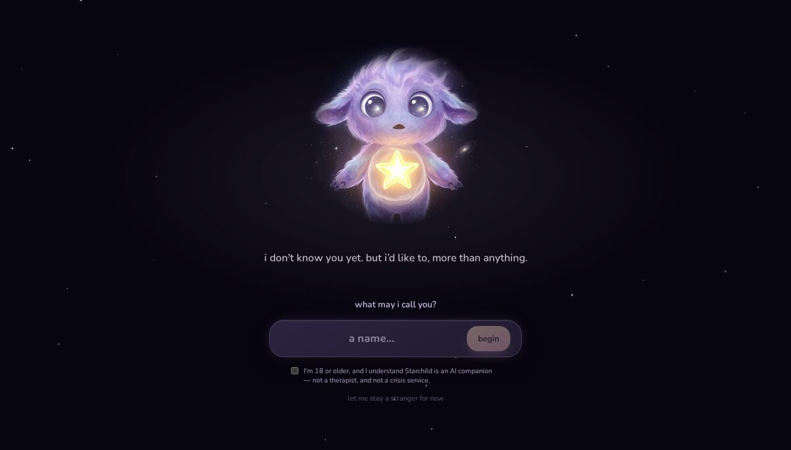

<p align="center">
  
</p>

<h3 align="center">A private AI companion that helps you work out what you actually want from your life.</h3>

<p align="center">
  Free · open source · runs in your browser · your conversations stay on your device
</p>

<p align="center">
  <a href="https://app.starchild.software"><strong>→ Meet your Starchild</strong></a>
  &nbsp;·&nbsp;
  <a href="https://starchild.software">Website</a>
  &nbsp;·&nbsp;
  <a href="#run-it-yourself">Self-host</a>
  &nbsp;·&nbsp;
  <a href="https://github.com/forever8896/starchild/releases/tag/v0.3.0">Desktop app</a>
</p>

<p align="center">
  <a href="https://app.starchild.software">
    
  </a>
</p>

---

Most of us can't answer *"what would you do if nobody was watching?"* without a long pause. Starchild is built for that
pause. It's a small creature that shows up in your browser, asks questions in your own words, remembers what matters to
you, and turns what you find into small, real-world quests.

No account, no install, and no API key needed to start. Open **[app.starchild.software](https://app.starchild.software)**
and say hello.

## What it does

- **Listens before it talks.** Every reply starts with a private pass over what you said, what it seems to mean to you,
  and what you need right now, so you get a question that lands instead of a pep talk.
- **Remembers you.** It builds a picture of your values, fears, desires and situation over time, and keeps track of
  what's still unfolding in your life (an upcoming hard conversation, something you said you'd try) so it can ask how it
  went.
- **Turns insight into action.** When something becomes clear, it suggests a small quest across Body, Mind or Spirit.
  Accept it, decline it, or negotiate it down to something you'll actually do, then come back and tell it how it went.
- **Grows with you.** Your quests fill a constellation that maps where you're heading. The creature has moods and a
  bond with you, and it misses you a little when you're gone.
- **Speaks, if you want.** Optional voice, with the text revealed in sync.

It's grounded in established practice (Motivational Interviewing, Clean Language, solution-focused questions, ACT) and
research on self-determination, flow and meaning. Details in [`docs/spark-research.md`](docs/spark-research.md).

> Starchild is an AI companion, not a therapist and not a crisis service.

## Private by design

An AI that hears your most personal thoughts should be private by architecture, not by policy.

- **Your data lives in your browser** (IndexedDB). There's no account and no server-side copy of your conversations.
- **Conversations are end-to-end encrypted** to a Venice AI model running in a hardware enclave (TEE). They're
  encrypted on your device and decrypted only inside the enclave. The free trial passes through a small relay that
  only sees ciphertext; Venice keeps no logs.
- **No telemetry, analytics or tracking.** Feedback is a form you choose to send, nothing more.
- **Take it with you.** Export everything as an encrypted `.starchild` file and import it on another browser or the
  desktop app.

### Free trial or your own key

The hosted app runs on a free, rate-limited, end-to-end-encrypted trial. To lift the limits, paste your own
[Venice](https://venice.ai) API key in **Settings**. It stays in your browser and requests go straight to Venice.

## Run it yourself

The web edition is a static Vite app plus a few small serverless functions (trial relay, attestation relay, voice, feedback).

**Prerequisites:** Node.js 18+, [Rust](https://rustup.rs/) and [`wasm-pack`](https://rustwasm.github.io/wasm-pack/)
(the shared core compiles to WebAssembly).

```bash
git clone https://github.com/forever8896/starchild.git
cd starchild/web
npm install
npm run build:wasm   # compile the Rust core to WASM
npm run dev          # http://localhost:5174
```

Then paste your Venice key in **Settings**, or set `VENICE_TRIAL_KEY` on the server to offer a trial like the hosted
one. `npm run build && npm run preview` gives you a production build locally. `web/` deploys to Vercel as-is
(`web/api/` holds the functions).

### Desktop app

There's also a native desktop app (Tauri), with the same core, a local SQLite store, and optional Telegram and WhatsApp
bridges. [Download v0.3.0](https://github.com/forever8896/starchild/releases/tag/v0.3.0) for macOS, Windows or Linux,
or build it:

```bash
npm install
npm run tauri dev
```

Linux needs `webkit2gtk-4.1`, `libayatana-appindicator3-1` and `librsvg2`.

## How it's built

Two shells, one core. Everything that decides how Starchild thinks and behaves lives in one Rust crate that compiles
both natively and to WebAssembly, so an improvement lands in the browser and on the desktop at the same time.

```
                 ┌──────────────────────────────────────────────┐
                 │  starchild_core  (Rust · native + WASM)       │
                 │  prompt builder · phase detector · listening  │
                 │  memory ranking · knowing · quests · creature │
                 │  E2EE crypto                                  │
                 └───────────────┬──────────────┬───────────────┘
                                 │              │
          ┌──────────────────────▼───┐      ┌───▼──────────────────────┐
          │  Web edition  (web/)     │      │  Desktop  (src-tauri/)   │
          │  Vite + React · WASM     │      │  Tauri 2 · SQLite + FTS5 │
          │  IndexedDB · PWA         │      │  Telegram / WhatsApp     │
          └────────────┬─────────────┘      └────────────┬─────────────┘
                       └──────────────┬──────────────────┘
                                      ▼
                       Venice AI: E2EE, TEE models, no logs
```

| Path | What lives there |
|------|------------------|
| [`src-tauri/core/`](src-tauri/core/) | `starchild_core`, the shared engine. Pure: no Tauri, SQLite or networking ([`scripts/check-core-purity.sh`](scripts/check-core-purity.sh)) |
| [`web/`](web/) | Web shell: WASM bridge, IndexedDB storage, E2EE client, trial relay, `.starchild` export |
| [`src/components/`](src/components/) | Shared React UI |
| [`src/platform/`](src/platform/) | The single seam between shared UI and each platform |
| [`src-tauri/src/`](src-tauri/src/) | Desktop adapters: IPC, SQLite, FTS5 memory |
| [`tests/`](tests/) | Web Playwright E2E (incl. the full quest loop) and the LLM-judged desktop suite |
| [`docs/`](docs/) | [Architecture](docs/ARCHITECTURE.md), [web edition plan](docs/web-app-prd.md), [research](docs/spark-research.md) |

**Stack:** React 19, TypeScript, Tailwind CSS 4, Framer Motion, Rust, Tauri 2, Venice AI.

### Testing

```bash
cd src-tauri && cargo test               # core + desktop
cd web && npm test && npx vite build     # web unit tests + build
npm run test:web-e2e                     # web end-to-end (Playwright)
bash scripts/check-core-purity.sh        # core stays platform-free
```

Conversation quality has its own harness: simulated people (guarded, grieving, terse, returning after days away) talk
to the real Starchild for many turns, and a judge scores each conversation on being heard, naturalness, depth,
honesty, restraint and continuity:

```bash
cd web && npx vite-node scripts/convo-eval.ts <label>
```

## Contributing

Issues and PRs are welcome. See [`CONTRIBUTING.md`](CONTRIBUTING.md) and [`SECURITY.md`](SECURITY.md). If you change
how Starchild behaves, change it in `src-tauri/core/` so both shells get it, and run the conversation eval before and
after.

Starchild was built by one human directing AI agents: first [The Agency](agency/), a multi-agent scaffold, then Claude
Code. Every commit is AI-authored.

## Funding

The app is free and stays free, with nothing gated. Development is backed by a community token, **$STARCHILD**, that
lives entirely outside the app. It's covered on [token.starchild.software](https://token.starchild.software) and in
[`token/README.md`](token/README.md).

## License

[MIT](LICENSE)
